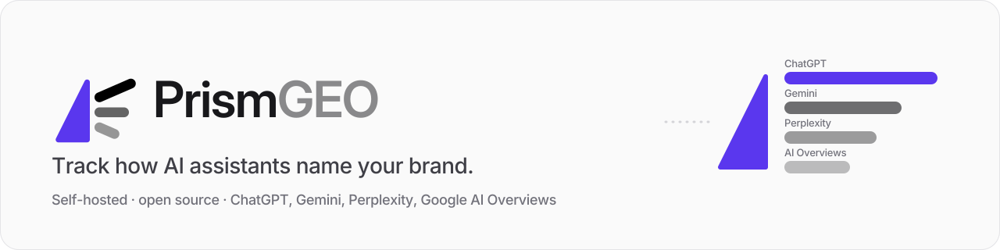

<p align="center">
  
</p>

<p align="center">
  <a href="LICENSE"></a>
  <a href="https://github.com/IliasSami/prism-geo/actions/workflows/ci.yml"></a>
  
</p>

# PrismGEO

**Track how AI assistants name your brand.** PrismGEO asks ChatGPT, Gemini, Perplexity, Google AI Overviews and AI Mode, and Microsoft Copilot the questions your buyers ask, stores only the answers the engines actually give, and shows how often each one names and cites you versus your competitors, and what to do about it. It works for free (your own browser and free accounts, paced so they are never exhausted) or with paid routes for steady, in-market data, and Claude can use it directly through MCP.

Everything runs on your machine: a Next.js dashboard, a Playwright crawler and a single SQLite file. No telemetry, no hosted service.

> **Beta testers wanted.** We are taking **10 beta users** (SEO and GEO consultants, agencies, in-house marketers) for feedback before the wider launch. [Apply here](https://github.com/IliasSami/prism-geo/issues/new?template=beta-tester.yml). It takes two minutes.

## Tested

PrismGEO is in public beta. This is what has been tested, and what has not:

- **Automated checks on every push:** lint, type checks for every package, 200+ unit and integration tests, a production build on Node 22.13 and 24, a dependency audit, a Docker build, and a fresh install that starts and opens the setup wizard on Ubuntu, macOS and Windows ([CI](https://github.com/IliasSami/prism-geo/actions/workflows/ci.yml)).
- **A real audit (October 2026):** 110 buyer questions for a real ecommerce SaaS brand and 5 competitors, run from one laptop with no API keys. ChatGPT (logged out) returned 133 answers and Gemini (logged out) 129, all stored with their sources, mentions and stance. Real-world problems found in that audit are fixed in [CHANGELOG.md](CHANGELOG.md) (for example, an engine's "I encountered an error" reply is now a failure, not an answer).
- **What didn't work without keys:** Google blocked AI Overviews and AI Mode for the automated browser on that connection, and logged-out Perplexity hit its anonymous cap after a few questions. PrismGEO recorded these as failures with the reason, as designed. For dependable Google and Perplexity data, add a free SerpApi key and a free Gemini key, or a signed-in session ([below](#staying-within-free-limits-automatic)).
- **Live-verified 1–2 November 2026** with signed-in sessions on all five engines: human checks and sign-ins raised in the bell and completed by a person while the audit waited; ChatGPT's signed-in session ignoring automated questions (now asked logged out instead, and labelled so); Copilot's move to copilot.com (its page currently fails to load its own texts and keeps questions unsent, reported as "not accepted").
- **Location:** a browser answers for the country your computer connects from. To measure another market (e.g. the US from abroad), use a provider route that asks from that country. See [Search location](#search-location-ask-from-your-buyers-country).

## What you get

| Page | Answers the question |
| :--- | :--- |
| **Overview** | Where do we stand? Mention rate, citation rate, questions you lead, top rival, most-cited sites, and a warning when answers confuse you with a look-alike domain. |
| **Competitors** | You vs each competitor, by engine and by question, with 95% ranges so small samples look small. Questions that name you are shown separately. |
| **Gaps** | Which questions you are losing, to whom, and which sources to get covered on to fix it. |
| **Sources** | Every page the engines cited, grouped by page or site, and the passages answers reused (only stored when the answer shares phrases with the page). |
| **Answers** | The full text each engine returned, with its sources and the web searches it ran (when exposed). |
| **The bell** (header) | What needs you right now: a human check or sign-in an engine is waiting for, with the questions held on it. Open the window, complete it yourself, and the audit carries on. |
| **Prompts / Engines / Settings** | Manage tracked questions; engine health and question coverage per engine; client profile, competitors, API keys, schedule and the Claude connector. |

**Accuracy rule:** only answers an engine actually returned are stored. Blocks, rate limits, empty pages and "no AI Overview" are recorded as failures with a reason (and a screenshot in `data/crawl-debug/`), never filled in.

## Install (one command)

You need [Node.js](https://nodejs.org) 22.13 or later and git. Then:

**macOS / Linux**
```bash
curl -fsSL https://raw.githubusercontent.com/IliasSami/prism-geo/main/install.sh | bash
cd prism-geo && pnpm start        # no pnpm? npx pnpm@10.34.9 start
```

**Windows (PowerShell)**
```powershell
irm https://raw.githubusercontent.com/IliasSami/prism-geo/main/install.ps1 | iex
cd prism-geo; pnpm start
```

Open **http://localhost:3333**. The installer downloads PrismGEO, its dependencies and the crawler's browser (Chromium, about 570 MB once; on Linux also its system libraries), creates `.env`, builds the dashboard and prints the Claude (MCP) configuration for your machine.

**Already cloned?** Run `pnpm bootstrap` (or `npx pnpm@10.34.9 bootstrap`) in the folder: it does the same and is safe to run again. `pnpm start` also builds and installs the browser by itself when they are missing, and moves to the next free port when 3333 is taken (or set `PRISMGEO_PORT` in `.env`).

**Docker** (no Node.js needed): see [Docker](#docker).

## How to use it, step by step

1. **Add your client.** The first visit opens the setup wizard: your brand (name, website, category), up to five competitors, and the buyer questions to track. PrismGEO drafts 10 questions from your category; edit them, and add more later on **Prompts**.
2. **Choose how engines are reached** (Settings → Engines & access). Free: keep **Hybrid** and connect your own free accounts on **Engines → Signed-in sessions** (a window opens, you sign in yourself; PrismGEO never sees passwords). Paid and in-market: add a SerpApi or Gemini key, or the DataForSEO data provider, and pick the **search location** (your buyers' country).
3. **Run a first audit.** Press **Run audit** in the header, pick a few questions and 1 run each. Engines run in parallel, one page at a time each, at a safe human pace; the dialog shows progress and keeps running if you close it.
4. **Answer the bell when it rings.** If an engine shows a "verify you are human" check or wants a sign-in, the bell at the top shows it and that engine waits (the others keep going). Click **Open window**, complete it yourself, close the window: the audit carries on. Turn on desktop alerts in the bell to be told while you work elsewhere.
5. **Fill the gaps.** Free engines are capped per hour and per day so they are never exhausted; questions over the cap wait. Run an audit with **Unanswered** to ask each engine only what it has never answered, or turn on the **rolling daily audit** (Settings → Schedule) and let PrismGEO cover everything over a few days by itself.
6. **Read the results.** **Overview** (where you stand and what needs attention), **Competitors** (you vs each rival per engine, with ranges), **Gaps** (questions you lose and the sources to get onto), **Sources** (every cited page and reused passage), **Answers** (the full text of every answer). **Download report** on Overview gives a shareable Markdown summary.
7. **Fix what it flags.** Each warning on Overview and Engines says why it happens and what to do next: a look-alike domain confusing engines with you, answers tailored to the country your computer is in instead of your market, an engine that needs a session or a key.
8. **Ask Claude.** Add the MCP server (the installer prints the exact command) and ask Claude things like "How visible is my brand on Perplexity versus competitors?", "Which questions do we lose and to whom?" or "Start an audit of the unanswered questions". See [Use it from Claude](#use-it-from-claude-mcp-connector).

## How each engine is reached

PrismGEO uses the most reliable route you have configured, per engine:

| Engine | Without a key | With a key | With DataForSEO (paid) | Notes |
| :--- | :--- | :--- | :--- | :--- |
| ChatGPT | Logged-out browser, or your signed-in free account | OpenAI Responses API with web search | The answer ChatGPT's interface showed | When the signed-in session ignores an automated question, it is asked logged out and stored as `browser` |
| Gemini | Logged-out browser, or signed in | Gemini API with Google Search grounding (free tier) | The answer Gemini's interface showed, with sources | Browser captures have no sources |
| Perplexity | Signed-in free account (anonymous use is capped quickly) | Perplexity Sonar API | Sonar API (your own Perplexity key is used first) | |
| Google AI Overviews | Browser, best with a signed-in Google session and slow pacing | SerpApi (free monthly tier) | The Overview on Google's results page | One IP gets "unusual traffic" blocks after a few dozen searches |
| Google AI Mode | none (Google blocks automated browsers from AI Mode) | SerpApi (free plan: 250 searches a month), or an Apify token (Apify's own AI Mode actor) | The AI Mode answer with its cited pages | Free alternative: capture by hand with the extension |
| Microsoft Copilot | **Signed-in Microsoft account only** (copilot.com) | none | none | Its page currently fails to load its own texts and keeps questions unsent; such runs are reported as "not accepted", not as answers. Capture by hand meanwhile |

Every engine can also be **captured by hand** with the free browser extension (below).

Modes (Settings → Engines & access): **Browser only**, **Keys and provider only** (the key or provider where one exists), **Hybrid** (browser first, key or provider when the browser is blocked). Every stored answer records how it was captured: `browser`, `browser_signed_in`, `api` (a model API), `provider` (the consumer interface, captured by DataForSEO) or `manual` (captured by hand). Dashboards warn when an engine's answers mix methods, because a model API answers differently from the app buyers use.

### Search location: ask from your buyers' country

Answers, sources and recommended companies differ by country, so every question is asked from one **search location** (Settings → Engines & access: pick a country, then one of the languages widely spoken there; default United States, English), the way a rank checker is set to a country.

- **Paid routes are asked from the search location:** DataForSEO (country or city), SerpApi (`gl`, `hl`, `location`), Apify (country), OpenAI web search and Perplexity Sonar (user location). Gemini's API has no location setting.
- **A browser on this computer is answered for the country this computer connects from** (or the proxy's). Before every audit PrismGEO checks that country, and every stored answer records where it was asked from (`searchedFrom`).
- By default audits run as before. When this computer is outside the search location and DataForSEO, SerpApi or Apify is saved, that route is used first for its engines, because it captures the same page from the right country.
- **Only search from here** (off by default): a route that would ask from another country is never used. When this computer is outside the search location, browser engines are skipped with the reason, and engines run through the routes above or through a proxy in that country that you control.

- **A city, state or postal code** (optional) narrows the search inside the country. Places come from Google's own geotargets list (downloaded once into `data/geo/`, never committed), so the name is exactly what Google, DataForSEO and SerpApi accept. Google routes and OpenAI use the place; the other engines are asked from the country.
- **Google's location signal (uule).** Google AI Overviews searched in the browser carry the place as Google's `uule` parameter with `gl` and `hl`, the way SERP location checkers work. uule changes where Google treats the search as coming from, not the connection, so these answers are labelled with both. Each Google answer also keeps the exact search address and the top 10 organic results on the same page.
- **Calibration** (Settings → Search location → Calibrate, or the `calibrate_location` MCP tool): for 10 of your questions, Google AI Overviews is searched once from this computer with uule and twice from inside the country through SerpApi or DataForSEO. The two reference searches set the noise floor; uule answers count as asked from the search location (also for "Only search from here") only when they agree with the reference as closely as the reference agrees with itself. Nothing from a calibration is stored as an answer.

`PRISMGEO_CONNECTION_COUNTRY=us` sets the connection country where the check cannot run (an offline server).

### Most accurate paid route: DataForSEO

Model APIs answer differently from the apps buyers use (published comparisons find only a minority of cited sources and named brands in common), so PrismGEO can use [DataForSEO](https://dataforseo.com) to capture what ChatGPT's and Gemini's interfaces, and Google's results page, actually showed. One pay-as-you-go account covers four engines at roughly $0.002–0.005 per answer (check their [current prices](https://dataforseo.com/pricing/ai-optimization/llm-scraper)).

1. Create an account and copy the API login and password from [app.dataforseo.com/api-access](https://app.dataforseo.com/api-access).
2. Settings → Engines & access → **Data provider**: paste `login:password`, choose the market (e.g. United States, United Kingdom) and language.
3. Choose **Keys and provider only** for steady results, or **Hybrid** to use it only when the browser is blocked.

Each answer keeps the provider, its cost and the model that answered. A refused login or an empty balance stops that engine with a clear reason; provider rate limits count as blocks; a results page without an Overview is recorded as "no AI Overview".

### Free and fully compliant: capture by hand

The **PrismGEO Capture** browser extension (`apps/extension`) saves the answer you are looking at in your own ChatGPT, Gemini, Perplexity, Copilot or Google account. You ask the question yourself; the extension only reads the page when you click it, shows what it will send, and sends it only to your PrismGEO. Answers are matched to your tracked questions (or added as new ones), checked like crawled answers and stored as `manual`. Hand captures never change an engine's health status. See [apps/extension/README.md](apps/extension/README.md) to install it.

### Staying within free limits (automatic)

PrismGEO never exhausts a free engine. Every browser question is counted per engine on this computer (answered or not), against limits researched from official docs, user reports and our own live tests (November 2026):

| Engine (free, browser) | Pause between questions | Per hour | Per day | Rest after blocks in a row |
| :--- | :--- | :--- | :--- | :--- |
| Google AI Overviews | 2–5 min | 8 | 30 | 6 h, 12 h, 24 h, 48 h |
| Perplexity logged out / signed in | 2–5 min / 1–3 min | 5 / 10 | 10 / 40 | 6 h, 12 h, 24 h |
| ChatGPT logged out / signed in | 1–3 min / 1.5–4 min | 15 / 8 | 60 / 30 | 1 h, 3 h, 6 h, 12 h, 24 h |
| Gemini logged out / signed in | 1–3 min / 1.5–4 min | 12 / 10 | 50 / 40 | 1 h … 24 h |
| Copilot (signed in) | 1.5–4 min | 10 | 40 | 1 h … 24 h |

- Over the **hourly** limit an engine waits inside the audit; at the **daily** limit its remaining questions are recorded as "paused to protect your free access" and asked by the next audit (in Hybrid mode a saved key takes over instead).
- After a block the engine's browser route rests for the times above across audits, so no audit searches into an active block; a successful answer ends the streak.
- **Settings → Schedule → Pacing → Fast** restores short pauses with no caps, for your own proxy or paid accounts only.
- Steady, larger volumes: a free **Gemini API key**, a **SerpApi** key (250 free searches a month, also covers Google AI Mode) or the **DataForSEO** provider, with **Hybrid** mode.
- **Rolling daily audit** (Settings → Schedule): each day it asks the questions measured longest ago (never-answered first) within these limits.

In browser mode the crawler presents a consistent desktop Chrome profile and hides the `navigator.webdriver` automation flag; it never solves CAPTCHAs, rotates IPs or retries past a block. Check each engine's terms before automating it, and prefer the API routes above where you can.

### When an engine asks for a person (the bell)

Some blocks are steps only a person can take: a "verify you are human" check (Cloudflare, Google's "unusual traffic" page) or a sign-in (an expired session, a logged-out wall). PrismGEO never answers these itself. Instead:

1. The engine that asked **waits** (15 minutes by default, `PRISMGEO_PERSON_WAIT_MIN` to change it, `0` to never wait); the other engines keep running.
2. The **bell** at the top of the dashboard shows the request, with the questions waiting on it. Turn on "Alert me on this computer" to get a desktop notification.
3. **Open window** opens a visible browser on the same saved profile and proxy the crawler uses. Complete the check or sign in yourself, then close the window. PrismGEO only watches whether the check is still shown.
4. The waiting engine asks the question again and carries on, so the audit finishes with nothing missing. If the very same step comes straight back after you completed it (the engine refuses the automated browser itself), PrismGEO records why and does not ask you again in that audit. If nobody came in time, the questions stay on the request: **Resume** asks exactly those once you have completed it. Rate limits and usage limits are not raised: they end by themselves, so the engine rests instead.

Without a signed-in account, a completed check is kept in a separate logged-out "visitor" profile that later logged-out runs reuse (a fresh browser per question would forget it). On a server without a screen (Docker, headless Linux) the request is still shown, but nothing waits for it; use a key or provider route there.

## Docker

```bash
docker compose up -d       # pulls ghcr.io/iliassami/prism-geo:latest; http://localhost:3333
docker compose ps          # "healthy" once /api/health answers
```

Without the repository: `docker run -d --init --shm-size=1g -p 127.0.0.1:3333:3333 -v prismgeo-data:/app/data ghcr.io/iliassami/prism-geo:latest`.

- Data lives in the named volume `prismgeo-data` (no folder permissions to change on any OS). To keep it in `./data` instead, see the comment in `docker-compose.yml`. `docker compose up -d --build` builds the image from your checkout.
- The image is built on Microsoft's Playwright image (Chromium and its libraries included) and runs as the unprivileged `pwuser`, with `node` started directly under an init process. Images are published for amd64 and arm64 on every release.
- compose publishes the port on `127.0.0.1` only. Publish it more widely only behind your own authentication (see [Security model](#security-model)). `PRISMGEO_PORT` changes the port inside the container.
- A container has no screen, so signed-in sessions and the bell's windows are not available (Copilot stays off); engines use logged-out browsing, API keys, the data provider and the rolling schedule.
- The rolling schedule's hour uses the container's time zone (UTC by default); set `TZ` in `docker-compose.yml`.

## Command line and cron

```bash
pnpm crawl                       # all active prompts, every enabled engine, 1 run each
pnpm crawl --rolling=15          # the 15 prompts measured longest ago (good for a daily cron)
pnpm crawl --engines=chatgpt,gemini --samples=3 --brand=<id or slug>
```

## Backup, restore and upgrades

Everything PrismGEO knows is in `data/`: the database `prismgeo.db`, plus `browser-profiles/` (signed-in sessions), `logs/`, `backups/` and `crawl-debug/`.

**Backup.** Settings → Data → **Download .db** (or `GET /api/backup`) streams a consistent snapshot of the whole database, for every client. The file contains your **API keys, the proxy password and the Claude connector token** in plain text: store it like a password. From a shell, with the server running or not: `sqlite3 data/prismgeo.db ".backup 'prismgeo-backup.db'"`.

**Restore.**
1. Stop PrismGEO (`Ctrl+C`, or `docker compose stop`).
2. Keep the current database aside: `mv data/prismgeo.db data/prismgeo.db.old` and delete `data/prismgeo.db-wal` and `data/prismgeo.db-shm` if present.
3. Copy the backup to `data/prismgeo.db` (in Docker: `docker compose cp prismgeo-backup.db prismgeo:/app/data/prismgeo.db` with the service stopped, then make it owned by `pwuser`).
4. Optionally check it: `sqlite3 data/prismgeo.db "PRAGMA integrity_check"` should print `ok`.
5. Start PrismGEO again.

**Upgrades.** Run the install command again (it updates the folder), or `git pull && pnpm bootstrap`; with Docker, `docker compose pull && docker compose up -d`. Database migrations run on start; before a migration changes data, PrismGEO copies the database into `data/backups/` first, so you can roll back by restoring that copy. Read [CHANGELOG.md](CHANGELOG.md) before upgrading.

## Security model

PrismGEO is a single-user, self-hosted tool. **It has no login.** Anyone who can reach the dashboard can read every client's data, change API keys and start crawls. So:

- **Localhost by default.** `pnpm start`, `pnpm dev` and the compose file listen on `127.0.0.1` only.
- **Host allowlist.** The server answers only to `localhost`, `127.0.0.1`, `[::1]`, the host in `PRISMGEO_URL` and the names in `PRISMGEO_ALLOWED_HOSTS`; any other `Host` or `X-Forwarded-Host` gets `421`. This stops DNS-rebinding attacks from web pages you visit. `0.0.0.0` is never accepted as a host name.
- **Same-origin JSON writes.** API calls that change data must be `application/json` from the dashboard's own origin; other pages cannot submit forms to it.
- **Expose it only behind authentication.** To reach PrismGEO from other machines, set `PRISMGEO_HOST=0.0.0.0` (or publish the Docker port) **and** put a reverse proxy with authentication in front (basic auth, OAuth proxy, Tailscale, Cloudflare Access...), then add its host name to `PRISMGEO_ALLOWED_HOSTS`.
- **The MCP endpoint** (`/api/mcp`) is the exception: it is protected by its own random token so a tunnel can reach it. Anyone with the token can read your data and start crawls; if it leaks, rotate it with `sqlite3 data/prismgeo.db "DELETE FROM system_settings WHERE key = 'mcp_connector_token'"` (a new one is created on next use). Prefer the `Authorization: Bearer` header; a token in the URL (`?token=`, needed for claude.ai) ends up in proxy and tunnel logs.
- **Secrets at rest.** API keys, the proxy password and the connector token are stored unencrypted in `data/prismgeo.db`, and signed-in sessions in `data/browser-profiles/`. Keep `data/` private (it is git-ignored and excluded from Docker builds) and treat backups as secrets.

Report vulnerabilities privately; see [SECURITY.md](SECURITY.md).

## Development

```bash
pnpm lint        # ESLint (eslint-config-next)
pnpm typecheck   # every package and the web app
pnpm test        # node:test suites in packages/*/test and apps/*/test
pnpm --filter @prismgeo/web build
```

CI runs these on Node 22.13.0 and 24, plus `pnpm audit --prod --audit-level=high`, a Docker build and a check that the Docker image's Playwright tag matches `pnpm-lock.yaml`.

## Use it from Claude (MCP connector)

PrismGEO ships an MCP server so Claude (Desktop, Code, or claude.ai) can read your data and run actions: overview, visibility report, answers, crawl status, start a crawl, add prompts and competitors, and guarded read-only SQL (one statement, at most 500 rows, stopped after a few seconds, never the settings table). Starting an audit of more than 50 runs needs an explicit confirmation, and answer text is returned as untrusted content.

`pnpm bootstrap` prints the exact commands for your machine, and Settings → **Claude connector** shows ready-to-paste config for:

- **Claude Desktop** (local stdio server; recommended): `{"mcpServers": {"prismgeo": {"command": "pnpm", "args": ["--silent", "--dir", "/path/to/prism-geo", "mcp"]}}}` (`--silent` keeps pnpm's own output off the protocol)
- **Claude Code, local**: `claude mcp add prismgeo -- pnpm --silent --dir /path/to/prism-geo mcp`
- **Claude Code, over HTTP** (while the dashboard runs): `claude mcp add --transport http prismgeo http://localhost:3333/api/mcp --header "Authorization: Bearer <token>"`
- **claude.ai**: needs an HTTPS tunnel to your machine; the token is part of the URL

## Configuration

`.env.example` lists the environment variables PrismGEO reads (host, port, allowed hosts, database path, log file, browser binary, proxy, how long an engine waits for you, API model names). `pnpm bootstrap` copies it to `.env`, which `pnpm start` and `pnpm dev` load; variables set in your shell win. With Docker, set them in `docker-compose.yml`.

API keys, proxy and schedule are set in the dashboard and stored in the local SQLite file (see [Security model](#security-model)).

## Architecture

```
apps/web          Next.js 15 dashboard and API routes (App Router)
packages/crawler  Playwright engines, API engines, orchestrator, scheduler, CLI
packages/core     Metrics (Wilson intervals, prominence, stance), reverse-RAG alignment, prompt synthesis
packages/db       SQLite (node:sqlite, WAL) with migrations on start
packages/mcp      MCP server (stdio + Streamable HTTP)
data/             prismgeo.db, browser-profiles/, crawl-debug/, logs/, backups/  (git-ignored)
```

## Limitations

- Engines change their pages often; selectors are re-verified when a capture rate drops (see the Engines page and `data/crawl-debug/`). A run where the page ignored the question is reported as "not accepted", never stored as an answer.
- Free engines are deliberately slow (see [Staying within free limits](#staying-within-free-limits-automatic)): covering 100+ questions on every engine takes a few days of the rolling schedule, or minutes with a key or the data provider.
- Answers from a browser describe a buyer in the country your computer connects from. To measure another market, use a provider route in that country or a proxy there that you control.
- API answers come from the same model families with web search, but without the consumer apps' personalization; they are labelled `api`.
- Gemini's consumer app shows sources as buttons, so browser captures of Gemini have no citations; the Gemini API route does.
- Small samples are noisy. Read the "likely" ranges, and prefer several runs per prompt over time.

## Contributing, security, license

See [CONTRIBUTING.md](CONTRIBUTING.md), [SECURITY.md](SECURITY.md) and [CHANGELOG.md](CHANGELOG.md). Licensed under [MIT](LICENSE).

Created and maintained by **Ilias Ahmed (Ilias Sami)**: [iliassami.com](https://iliassami.com) · [@IliasSami](https://github.com/IliasSami)
