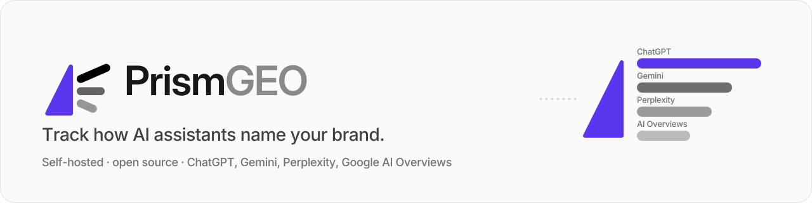

<p align="center">
  
</p>

<p align="center">
  <a href="LICENSE"></a>
  <a href="https://github.com/IliasSami/prism-geo/actions/workflows/ci.yml"></a>
  
</p>

# PrismGEO

**Track how AI assistants name your brand.** PrismGEO asks ChatGPT, Gemini, Perplexity and Google AI Overviews the questions your buyers ask, stores only the answers the engines actually give, and shows how often each one names and cites you versus your competitors, and what to do about it. Microsoft Copilot works once you connect a signed-in session.

Everything runs on your machine: a Next.js dashboard, a Playwright crawler and a single SQLite file. No telemetry, no hosted service.

> **Beta testers wanted.** We are taking **10 beta users** (SEO and GEO consultants, agencies, in-house marketers) for feedback before the wider launch. [Apply here](https://github.com/IliasSami/prism-geo/issues/new?template=beta-tester.yml). It takes two minutes.

## Tested

PrismGEO is in public beta. This is what has been tested, and what has not:

- **Automated checks on every push:** lint, type checks for every package, 157 unit and integration tests, a production build on Node 22.13 and 24, a dependency audit, a Docker build, and a fresh install that starts and opens the setup wizard on Ubuntu, macOS and Windows ([CI](https://github.com/IliasSami/prism-geo/actions/workflows/ci.yml)).
- **A real audit (October 2026):** 110 buyer questions for a real ecommerce SaaS brand and 5 competitors, run from one laptop with no API keys. ChatGPT (logged out) returned 133 answers and Gemini (logged out) 129, all stored with their sources, mentions and stance. Real-world problems found in that audit are fixed in [CHANGELOG.md](CHANGELOG.md) (for example, an engine's "I encountered an error" reply is now a failure, not an answer).
- **What didn't work without keys:** Google blocked AI Overviews and AI Mode for the automated browser on that connection, and logged-out Perplexity hit its anonymous cap after a few questions. PrismGEO recorded these as failures with the reason, as designed. For dependable Google and Perplexity data, add a free SerpApi key and a free Gemini key, or a signed-in session ([below](#staying-within-rate-limits-for-free)).
- **Location:** a browser answers for the country your computer connects from. To measure another market (e.g. the US from abroad), use a provider route that asks from that country. See [Search location](#search-location-ask-from-your-buyers-country).

## What you get

| Page | Answers the question |
| :--- | :--- |
| **Overview** | Where do we stand? Mention rate, citation rate, questions you lead, top rival, most-cited sites, and a warning when answers confuse you with a look-alike domain. |
| **Competitors** | You vs each competitor, by engine and by question, with 95% ranges so small samples look small. Questions that name you are shown separately. |
| **Gaps** | Which questions you are losing, to whom, and which sources to get covered on to fix it. |
| **Sources** | Every page the engines cited, grouped by page or site, and the passages answers reused (only stored when the answer shares phrases with the page). |
| **Answers** | The full text each engine returned, with its sources and the web searches it ran (when exposed). |
| **Prompts / Engines / Settings** | Manage tracked questions; engine health and question coverage per engine; client profile, competitors, API keys, schedule and the Claude connector. |

**Accuracy rule:** only answers an engine actually returned are stored. Blocks, rate limits, empty pages and "no AI Overview" are recorded as failures with a reason (and a screenshot in `data/crawl-debug/`), never filled in.

## How each engine is reached

PrismGEO uses the most reliable route you have configured, per engine:

| Engine | Without a key | With a key | With DataForSEO (paid) | Notes |
| :--- | :--- | :--- | :--- | :--- |
| ChatGPT | Logged-out browser, or your signed-in free account | OpenAI Responses API with web search | The answer ChatGPT's interface showed | Logged-out works well |
| Gemini | Logged-out browser, or signed in | Gemini API with Google Search grounding (free tier) | The answer Gemini's interface showed, with sources | Browser captures have no sources |
| Perplexity | Signed-in free account (anonymous use is capped quickly) | Perplexity Sonar API | Sonar API (your own Perplexity key is used first) | |
| Google AI Overviews | Browser, best with a signed-in Google session and slow pacing | SerpApi (free monthly tier) | The Overview on Google's results page | One IP gets "unusual traffic" blocks after a few dozen searches |
| Google AI Mode | none (Google blocks automated browsers from AI Mode) | SerpApi (free plan: 250 searches a month), or an Apify token (Apify's own AI Mode actor) | The AI Mode answer with its cited pages | Free alternative: capture by hand with the extension |
| Microsoft Copilot | **Signed-in Microsoft account only** | none | none | Copilot has no logged-out chat: without a connected session it is switched off and skipped in audits |

Every engine can also be **captured by hand** with the free browser extension (below).

Modes (Settings → Engines & access): **Browser only**, **Keys and provider only** (the key or provider where one exists), **Hybrid** (browser first, key or provider when the browser is blocked). Every stored answer records how it was captured: `browser`, `browser_signed_in`, `api` (a model API), `provider` (the consumer interface, captured by DataForSEO) or `manual` (captured by hand). Dashboards warn when an engine's answers mix methods, because a model API answers differently from the app buyers use.

### Search location: ask from your buyers' country

Answers, sources and recommended companies differ by country, so every question is asked from one **search location** (Settings → Engines & access: pick a country, then one of the languages widely spoken there; default United States, English), the way a rank checker is set to a country.

- **Paid routes are asked from the search location:** DataForSEO (country or city), SerpApi (`gl`, `hl`, `location`), Apify (country), OpenAI web search and Perplexity Sonar (user location). Gemini's API has no location setting.
- **A browser on this computer is answered for the country this computer connects from** (or the proxy's). Before every audit PrismGEO checks that country, and every stored answer records where it was asked from (`searchedFrom`).
- By default audits run as before. When this computer is outside the search location and DataForSEO, SerpApi or Apify is saved, that route is used first for its engines, because it captures the same page from the right country.
- **Only search from here** (off by default): a route that would ask from another country is never used. When this computer is outside the search location, browser engines are skipped with the reason, and engines run through the routes above or through a proxy in that country that you control.

- **A city, state or postal code** (optional) narrows the search inside the country. Places come from Google's own geotargets list (downloaded once into `data/geo/`, never committed), so the name is exactly what Google, DataForSEO and SerpApi accept. Google routes and OpenAI use the place; the other engines are asked from the country.
- **Google's location signal (uule).** Google AI Overviews searched in the browser carry the place as Google's `uule` parameter with `gl` and `hl`, the way SERP location checkers work. uule changes where Google treats the search as coming from, not the connection, so these answers are labelled with both. Each Google answer also keeps the exact search address and the top 10 organic results on the same page.
- **Calibration** (Settings → Search location → Calibrate, or the `calibrate_location` MCP tool): for 10 of your questions, Google AI Overviews is searched once from this computer with uule and twice from inside the country through SerpApi or DataForSEO. The two reference searches set the noise floor; uule answers count as asked from the search location (also for "Only search from here") only when they agree with the reference as closely as the reference agrees with itself. Nothing from a calibration is stored as an answer.

`PRISMGEO_CONNECTION_COUNTRY=us` sets the connection country where the check cannot run (an offline server).

### Most accurate paid route: DataForSEO

Model APIs answer differently from the apps buyers use (published comparisons find only a minority of cited sources and named brands in common), so PrismGEO can use [DataForSEO](https://dataforseo.com) to capture what ChatGPT's and Gemini's interfaces, and Google's results page, actually showed. One pay-as-you-go account covers four engines at roughly $0.002–0.005 per answer (check their [current prices](https://dataforseo.com/pricing/ai-optimization/llm-scraper)).

1. Create an account and copy the API login and password from [app.dataforseo.com/api-access](https://app.dataforseo.com/api-access).
2. Settings → Engines & access → **Data provider**: paste `login:password`, choose the market (e.g. United States, United Kingdom) and language.
3. Choose **Keys and provider only** for steady results, or **Hybrid** to use it only when the browser is blocked.

Each answer keeps the provider, its cost and the model that answered. A refused login or an empty balance stops that engine with a clear reason; provider rate limits count as blocks; a results page without an Overview is recorded as "no AI Overview".

### Free and fully compliant: capture by hand

The **PrismGEO Capture** browser extension (`apps/extension`) saves the answer you are looking at in your own ChatGPT, Gemini, Perplexity, Copilot or Google account. You ask the question yourself; the extension only reads the page when you click it, shows what it will send, and sends it only to your PrismGEO. Answers are matched to your tracked questions (or added as new ones), checked like crawled answers and stored as `manual`. Hand captures never change an engine's health status. See [apps/extension/README.md](apps/extension/README.md) to install it.

### Staying within rate limits, for free

1. Add a free **Gemini API key** (aistudio.google.com) and a free **SerpApi key** (it also covers Google AI Mode), and choose **Hybrid**.
2. **Connect signed-in sessions** (Engines page): a browser window opens on the machine running PrismGEO, you sign in yourself, and crawls reuse that session. PrismGEO never sees your password. This needs a desktop (a screen); it is not available on a headless server or in Docker.
3. Turn on the **rolling daily audit** (Settings → Schedule & network): each day it re-asks the N prompts measured longest ago instead of everything at once, so every engine sees a small, human-paced number of queries.
4. Optionally route browser engines through **a proxy you control** (office network or a paid provider). Free public proxies are not recommended: they can read or alter your traffic, including signed-in sessions.

The crawler paces queries per engine, slows down after a block, cools down for 10/20/30 minutes and retries, and only then gives up on that engine for the batch. In browser mode it presents a consistent desktop Chrome profile and hides the `navigator.webdriver` automation flag; it does not solve CAPTCHAs, rotate IPs or retry past a block. Check each engine's terms before automating it, and prefer the API routes above where you can.

## Quick start

Works on macOS, Windows and Linux. Requirements: [Node.js](https://nodejs.org) 22.13 or later (PrismGEO uses the built-in `node:sqlite`) and pnpm 10. If you don't have pnpm, run `corepack enable` once (it ships with Node).

```bash
git clone https://github.com/IliasSami/prism-geo.git
cd prism-geo
pnpm install
pnpm browsers     # downloads the Chromium build that matches the locked Playwright version
pnpm build
pnpm start        # open http://localhost:3333
```

The first visit opens the setup wizard: your brand, your competitors, then PrismGEO writes 10 buyer questions for you to review. Press **Run audit** in the header (start small: a few questions, 1 run each).

- **Linux:** if Chromium won't start, install its system libraries once: `pnpm --filter @prismgeo/crawler exec playwright install-deps chromium` (needs sudo).
- **While developing:** `pnpm dev` instead of `build` + `start`.
- Every push is checked by a fresh install on Ubuntu, macOS and Windows ([CI](https://github.com/IliasSami/prism-geo/actions/workflows/ci.yml)). See [Security model](#security-model) before making it reachable from other machines.

## Docker

```bash
mkdir -p data && sudo chown 1001:1001 data   # the container runs as pwuser (uid 1001)
docker compose up -d --build                 # http://localhost:3333, data in ./data
docker compose ps                            # shows "healthy" once /api/health answers
```

- The image is built on Microsoft's Playwright image (Chromium and its libraries included) and runs as the unprivileged `pwuser`, with `node` started directly under an init process.
- compose publishes the port on `127.0.0.1` only. Publish it more widely only behind your own authentication (see [Security model](#security-model)).
- Signed-in sessions need a visible browser window, so Copilot stays off in Docker; the other engines use logged-out browsing, API keys and the rolling schedule.
- The rolling schedule's hour uses the container's time zone (UTC by default); set `TZ` in `docker-compose.yml`.
- Upgrading from an image that ran as root: `docker compose run --rm --user root --entrypoint chown prismgeo -R pwuser:pwuser /app/data` once.

## Command line and cron

```bash
pnpm crawl                       # all active prompts, every enabled engine, 1 run each
pnpm crawl --rolling=15          # the 15 prompts measured longest ago (good for a daily cron)
pnpm crawl --engines=chatgpt,gemini --samples=3 --brand=<id or slug>
```

## Backup, restore and upgrades

Everything PrismGEO knows is in `data/`: the database `prismgeo.db`, plus `browser-profiles/` (signed-in sessions), `logs/`, `backups/` and `crawl-debug/`.

**Backup.** Settings → Data → **Download .db** (or `GET /api/backup`) streams a consistent snapshot of the whole database, for every client. The file contains your **API keys, the proxy password and the Claude connector token** in plain text: store it like a password. From a shell, with the server running or not: `sqlite3 data/prismgeo.db ".backup 'prismgeo-backup.db'"`.

**Restore.**
1. Stop PrismGEO (`Ctrl+C`, or `docker compose stop`).
2. Keep the current database aside: `mv data/prismgeo.db data/prismgeo.db.old` and delete `data/prismgeo.db-wal` and `data/prismgeo.db-shm` if present.
3. Copy the backup to `data/prismgeo.db` (in Docker, make sure it is owned by uid 1001).
4. Optionally check it: `sqlite3 data/prismgeo.db "PRAGMA integrity_check"` should print `ok`.
5. Start PrismGEO again.

**Upgrades.** `git pull && pnpm install && pnpm browsers && pnpm build`, or `docker compose up -d --build`. Database migrations run on start; before a migration changes data, PrismGEO copies the database into `data/backups/` first, so you can roll back by restoring that copy. Read [CHANGELOG.md](CHANGELOG.md) before upgrading.

## Security model

PrismGEO is a single-user, self-hosted tool. **It has no login.** Anyone who can reach the dashboard can read every client's data, change API keys and start crawls. So:

- **Localhost by default.** `pnpm start`, `pnpm dev` and the compose file listen on `127.0.0.1` only.
- **Host allowlist.** The server answers only to `localhost`, `127.0.0.1`, `[::1]`, the host in `PRISMGEO_URL` and the names in `PRISMGEO_ALLOWED_HOSTS`; any other `Host` or `X-Forwarded-Host` gets `421`. This stops DNS-rebinding attacks from web pages you visit. `0.0.0.0` is never accepted as a host name.
- **Same-origin JSON writes.** API calls that change data must be `application/json` from the dashboard's own origin; other pages cannot submit forms to it.
- **Expose it only behind authentication.** To reach PrismGEO from other machines, set `PRISMGEO_HOST=0.0.0.0` (or publish the Docker port) **and** put a reverse proxy with authentication in front (basic auth, OAuth proxy, Tailscale, Cloudflare Access...), then add its host name to `PRISMGEO_ALLOWED_HOSTS`.
- **The MCP endpoint** (`/api/mcp`) is the exception: it is protected by its own random token so a tunnel can reach it. Anyone with the token can read your data and start crawls; if it leaks, rotate it with `sqlite3 data/prismgeo.db "DELETE FROM system_settings WHERE key = 'mcp_connector_token'"` (a new one is created on next use). Prefer the `Authorization: Bearer` header; a token in the URL (`?token=`, needed for claude.ai) ends up in proxy and tunnel logs.
- **Secrets at rest.** API keys, the proxy password and the connector token are stored unencrypted in `data/prismgeo.db`, and signed-in sessions in `data/browser-profiles/`. Keep `data/` private (it is git-ignored and excluded from Docker builds) and treat backups as secrets.

Report vulnerabilities privately; see [SECURITY.md](SECURITY.md).

## Development

```bash
pnpm lint        # ESLint (eslint-config-next)
pnpm typecheck   # every package and the web app
pnpm test        # node:test suites in packages/*/test and apps/*/test
pnpm --filter @prismgeo/web build
```

CI runs these on Node 22.13.0 and 24, plus `pnpm audit --prod --audit-level=high`, a Docker build and a check that the Docker image's Playwright tag matches `pnpm-lock.yaml`.

## Use it from Claude (MCP connector)

PrismGEO ships an MCP server so Claude (Desktop, Code, or claude.ai) can read your data and run actions: overview, visibility report, answers, crawl status, start a crawl, add prompts and competitors, and guarded read-only SQL (one statement, at most 500 rows, a few seconds, never the settings table).

Settings → **Claude connector** shows ready-to-paste config for:

- **Claude Desktop** (local stdio server; recommended)
- **Claude Code**: `claude mcp add --transport http prismgeo http://localhost:3333/api/mcp --header "Authorization: Bearer <token>"`
- **claude.ai**: needs an HTTPS tunnel to your machine; the token is part of the URL

## Configuration

`.env.example` lists the environment variables PrismGEO reads (host, port, allowed hosts, database path, log file, browser binary, proxy, API model names). Export them in your shell, process manager or Docker environment; Next.js only loads `.env` files from `apps/web/`.

API keys, proxy and schedule are set in the dashboard and stored in the local SQLite file (see [Security model](#security-model)).

## Architecture

```
apps/web          Next.js 15 dashboard and API routes (App Router)
packages/crawler  Playwright engines, API engines, orchestrator, scheduler, CLI
packages/core     Metrics (Wilson intervals, prominence, stance), reverse-RAG alignment, prompt synthesis
packages/db       SQLite (node:sqlite, WAL) with migrations on start
packages/mcp      MCP server (stdio + Streamable HTTP)
data/             prismgeo.db, browser-profiles/, crawl-debug/, logs/, backups/  (git-ignored)
```

## Limitations

- Engines change their pages often; selectors are re-verified when a capture rate drops (see the Engines page and `data/crawl-debug/`).
- API answers come from the same model families with web search, but without the consumer apps' personalization; they are labelled `api`.
- Gemini's consumer app shows sources as buttons, so browser captures of Gemini have no citations; the Gemini API route does.
- Small samples are noisy. Read the "likely" ranges, and prefer several runs per prompt over time.

## Contributing, security, license

See [CONTRIBUTING.md](CONTRIBUTING.md), [SECURITY.md](SECURITY.md) and [CHANGELOG.md](CHANGELOG.md). Licensed under [MIT](LICENSE).

Created and maintained by **Ilias Ahmed (Ilias Sami)**: [iliassami.com](https://iliassami.com) · [@IliasSami](https://github.com/IliasSami)
